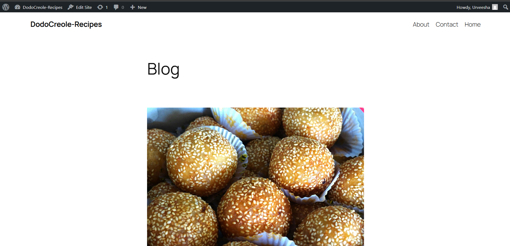
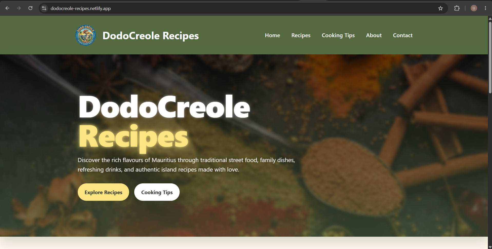
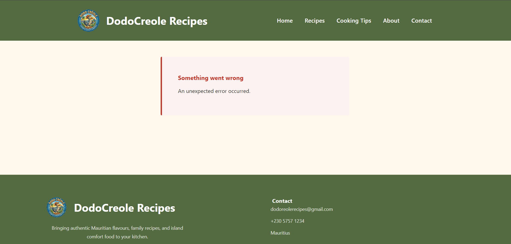
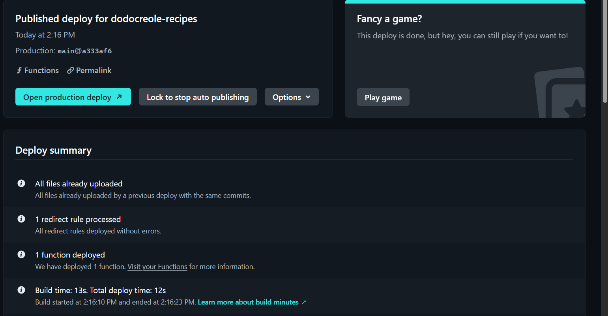

# Known Issues

## Netlify Frontend API Integration

The React frontend was successfully deployed to Netlify and the WordPress backend was successfully restored and hosted on InfinityFree.

### Working Components

- InfinityFree WordPress deployment is accessible.
- WordPress REST API endpoints are functioning correctly.
- Netlify deployment builds successfully.
- Homepage loads correctly on Netlify.
- HTTPS configuration works correctly.
- Local React development version works correctly with the WordPress content.

### Current Issue

Dynamic frontend pages including:

- Recipes
- Cooking Tips
- About
- Contact

currently display an “Unexpected error occurred” message on the Netlify deployment.

The issue appears related to the React frontend/API integration when fetching live WordPress data from the deployed backend environment.

### Troubleshooting Attempted

- CORS plugin configuration for localhost and Netlify.
- HTTPS migration for the InfinityFree WordPress backend.
- Netlify environment variable updates.
- Netlify redirects/proxy configuration.
- Netlify Functions proxy attempt.
- Safe React rendering checks in `PostCard.jsx`.
- WordPress API verification using direct REST API links.
- Netlify redeployment and cache clearing.
- Browser developer tools checks using Console and Network tabs.

### Current Status

The local development environment works correctly with LocalWP. The live WordPress backend is accessible and the REST API opens correctly when tested directly. The remaining issue only affects the live Netlify frontend integration for dynamic pages.

### Intended Resolution

I would continue debugging the failed live integration by:
- checking the live Network requests in Chrome DevTools
- comparing the local API response with the live API response
- confirming that the React build uses the correct Netlify environment variables.
  
I would also further inspect the affected React components to ensure they safely handle any missing fields returned by the live WordPress API.

---

# Evidence Screenshots

## InfinityFree WordPress Site Accessible

## Netlify Homepage Working

## Netlify Dynamic Page Error

## Netlify Deployment Published

