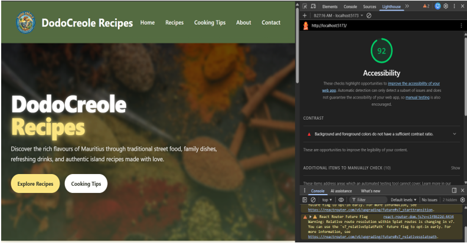
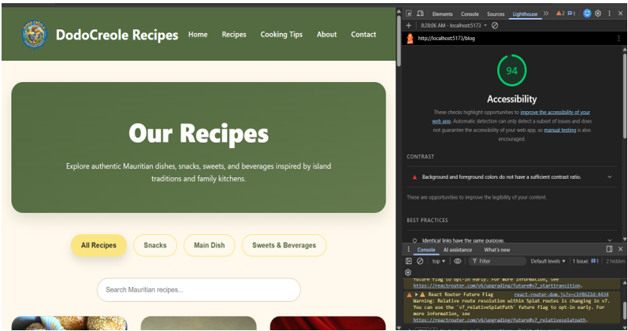
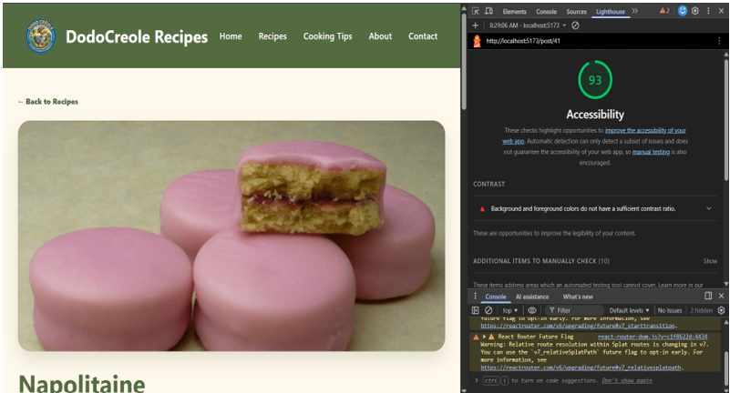
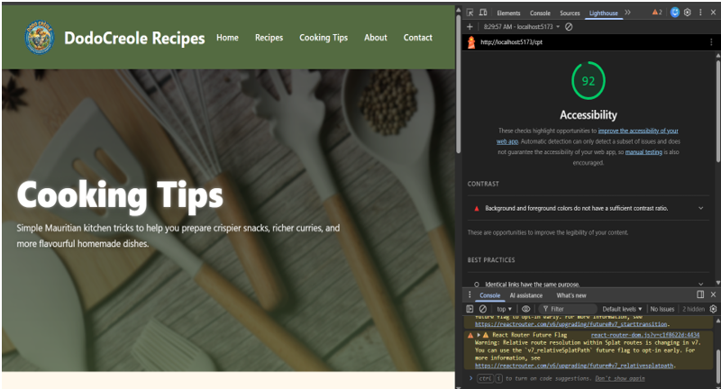
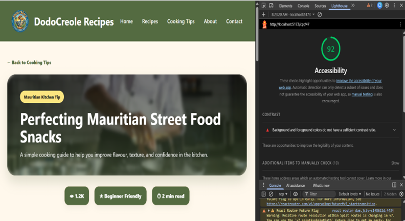
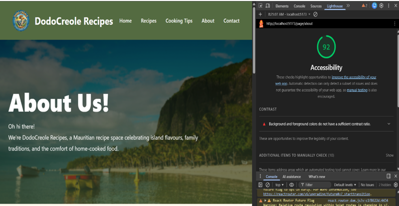
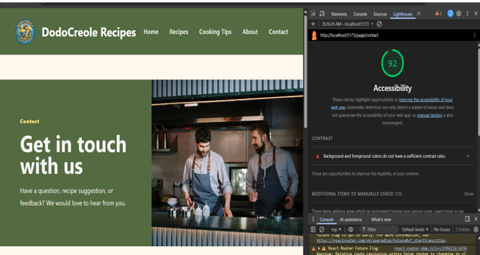

# Lighthouse Accessibility Audit

## Overview

Lighthouse accessibility audits were performed using Google Chrome DevTools on the DodoCreole Recipes React + WordPress website.

The audit focused on accessibility and usability across all major pages of the website.

---

# Accessibility Scores

# Accessibility Scores

# Accessibility Scores

- Home Page — 92
- Recipes Page — 94
- Single Recipe Page — 93
- Cooking Tips Page — 92
- Cooking Tip Detail Page — 92
- About Page — 92
- Contact Page — 92

---

# Improvements Implemented

Several accessibility improvements were applied throughout the project:

- Responsive layouts for different screen sizes
- Clear and readable typography
- Consistent colour palette and spacing
- Accessible navigation links
- Semantic HTML structure
- Proper image alt text
- Clear button styling and hover states
- Structured page hierarchy using headings

---

# Notes

Some pages displayed minor Lighthouse contrast warnings due to stylistic colour choices used within the site branding. However, all pages still achieved accessibility scores above 90.

The website was designed to balance accessibility, visual identity, and responsive user experience.

---

# Audit Screenshots

## Home Page

## Recipes Page

## Single Recipe Page

## Cooking Tips Page

## Cooking Tip Detail Page

## About Page

## Contact Page

